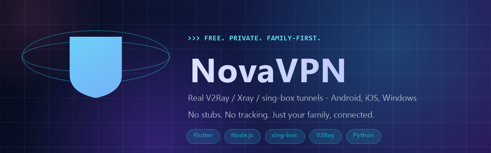

# NovaVPN

**Бесплатный и быстрый VPN.** Публичные конфиги, сквозной трафик через серверы
из разных стран и никакой обязательной регистрации.

[Скачать](#скачать) · [Возможности](#возможности) · [Поддержка](#поддержка)

---

## Что это

NovaVPN — приложение, которое поднимает защищённый туннель и направляет трафик
через один из доступных серверов. Вам не нужно искать и вставлять конфиги
вручную: приложение само собирает список, проверяет их и показывает лучшие.

Приложение **не требует аккаунта** и не просит email, телефон или карту.
Установка бесплатна.

## Скачать

Актуальщая версия — **v1.0.0**. Файлы лежат в разделе
[Releases](https://github.com/Ron4i/NovaVPN/releases/latest).

| Платформа | Файл | Размер | Системные требования |
|---|---|---|---|
| Android | `novavpn-android.apk` | ~158 МБ | Android 7.0 и новее |
| Windows | `novavpn-windows.exe` | ~11 МБ | Windows 10 x64 и новее |
| iOS | *приложение в App Store* | — | iOS 14 и новее |

<b>Установка на Android</b>

APK скачивается не из Google Play, поэтому нужно разрешить установку из
неизвестных источников:

1. Откройте загруженный `novavpn-android.apk`.
2. Если появится предупреждение — нажмите **Настройки** и включите
   «Разрешить установку из этого источника».
3. Вернитесь и подтвердите установку.

> Файл подписан тем же ключом, что и предыдущие сборки — обновление
> установится поверх старой версии без удаления данных.

<b>Установка на Windows</b>

1. Запустите `novavpn-windows.exe`.
2. Если появится синий экран SmartScreen — нажмите **Подробнее** →
   **Выполнить в любом случае**. Это стандартное поведение для программ,
   у которых мало скачиваний и нет подписи кода Microsoft.
3. При первом запуске приложение запросит разрешение на установку
   VPN-драйвера — нажмите **Да**.

<b>Как включить VPN</b>

1. Откройте приложение — вы увидите большую круглую кнопку.
2. Нажмите её один раз. Приложение подберёт самый быстрый доступный сервер.
3. Дождитесь, когда кнопка станет зелёной и появится надпись **«Подключено»**.

Чтобы выбрать страну вручную, откройте список серверов и нажмите на нужный.
Чтобы увидеть, через какую страну идёт трафик прямо сейчас, —
нажмите на строку подключения.

## Возможности

| | |
|---|---|
| **Без регистрации** | Не нужен email, телефон или карта. Открыл и работаешь |
| **Автовыбор сервера** | Приложение само находит самый быстрый доступный узел |
| **Множество стран | Серверы в Европе, Азии и Америке |
| **Сквозной трафик | Режим, при котором VPN забирает весь интернет-трафик устройства |
| **Ручной выбор | Можно выбрать конкретную страну вместо автопилота |
| **Свои конфиги | Свою подписку или отдельный конфиг можно загрузить в приложение |
| **Народные серверы | Пользователи могут сами предлагать конфиги в общий пул |
| **Один тап | Включение и выключение в одно касание |

## Как это устроено

Для тех, кому интересно, что происходит внутри:

- Ядро туннеля — **V2Ray / Xray** (Android, iOS) и **sing-box** (Windows)
- Списки конфигов собираются из открытых источников и фильтруются
  по реальному пингу до IP-адреса в каждой стране
- Приложение показывает только те серверы, которые отвечают

## Поддержка

Нашли проблему или есть идея — напишите:

- **Баг или идея** → [Issues](https://github.com/Ron4i/NovaVPN/issues)
- **Вопрос** → [Discussions](https://github.com/Ron4i/NovaVPN/discussions)
- **Уязвимость в безопасности** → не создавайте публичный issue,
  напишите в [Security Advisory](https://github.com/Ron4i/NovaVPN/security/advisories/new)

## Лицензия

Исходный код NovaVPN закрыт и является собственностью автора.
Подробности — в [LICENSE](LICENSE).

© NovaVPN

